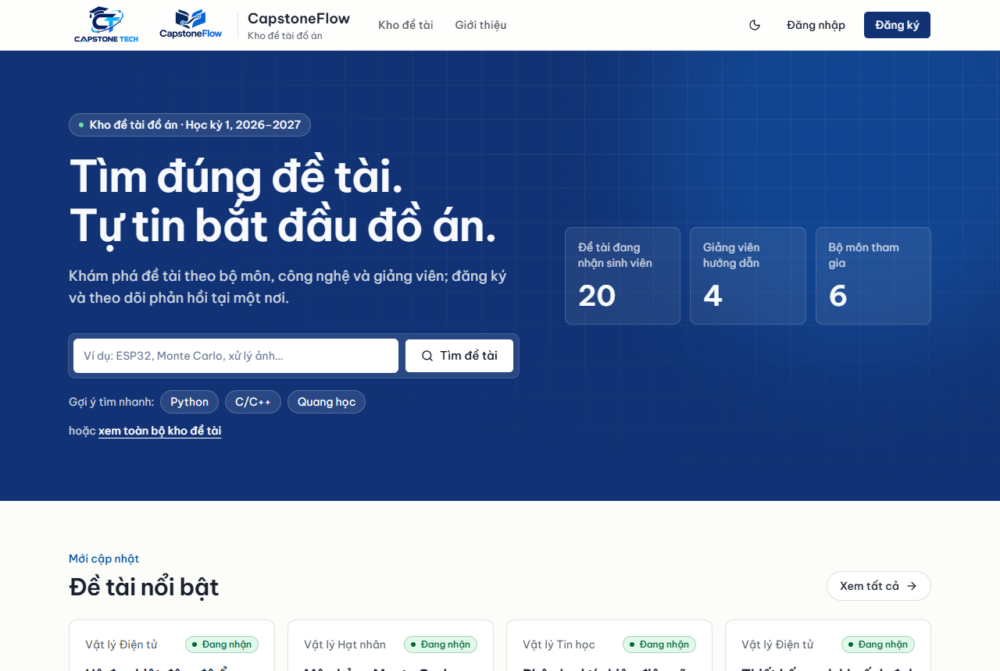
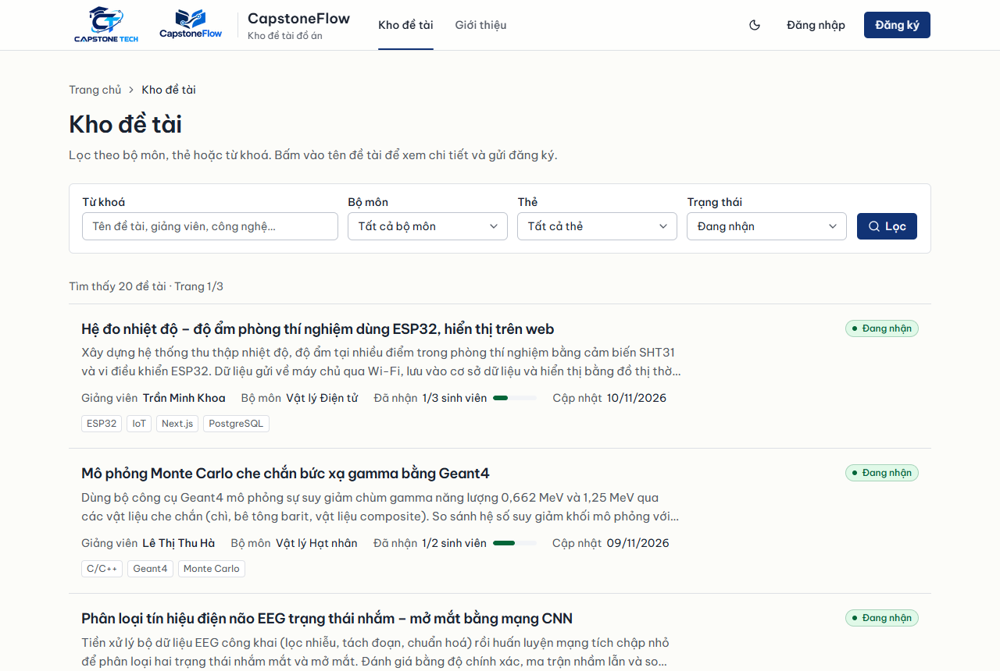
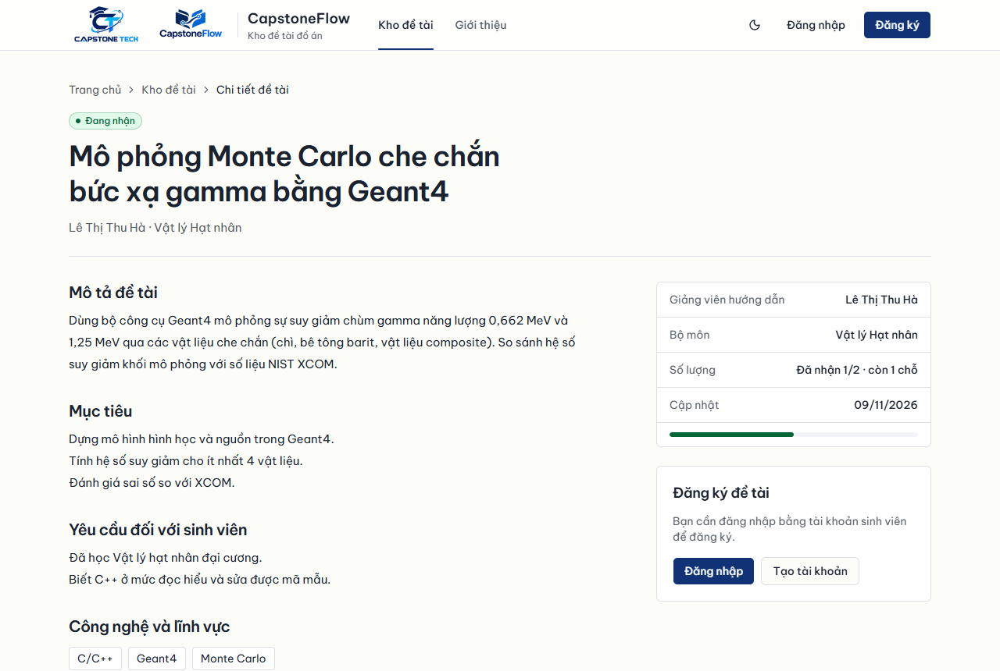
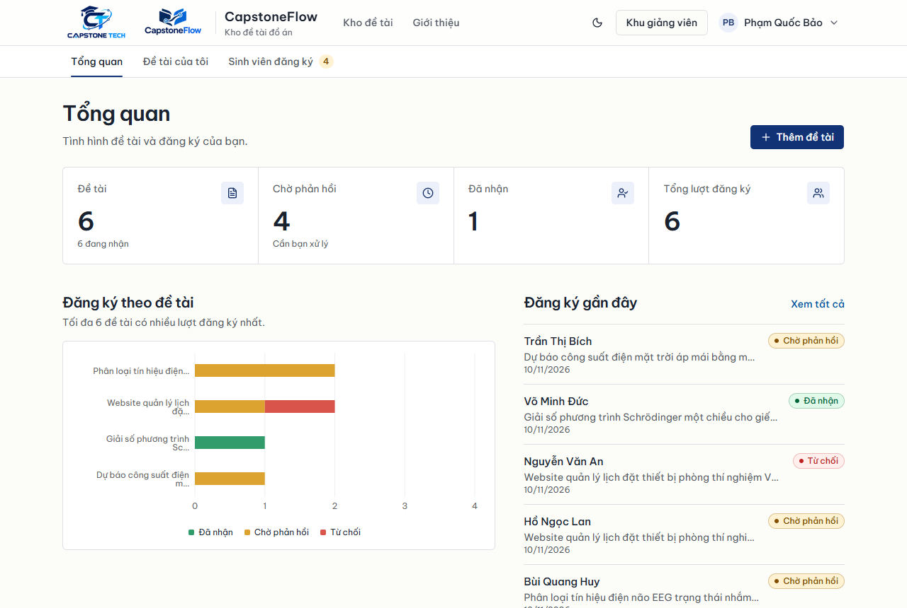
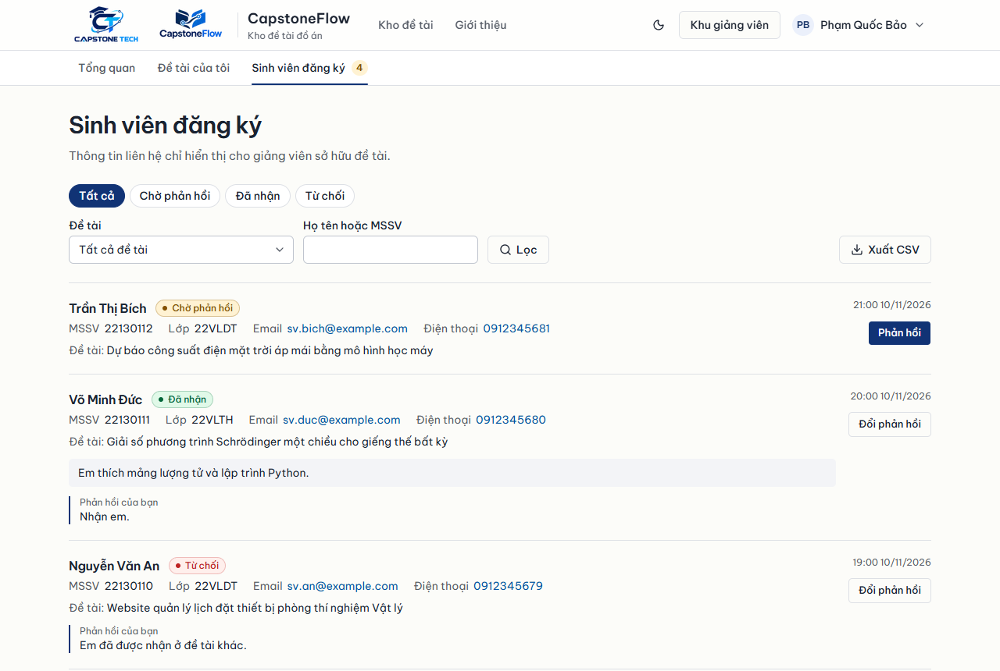

# CapstoneFlow

Kho đề tài đồ án của Khoa Vật lý – Vật lý Kỹ thuật. Giảng viên công bố đề tài; sinh viên tìm kiếm, đăng ký trực tuyến và theo dõi phản hồi; quản trị viên cấp vai trò và quản lý danh mục. Đồ án nhóm môn Phát triển ứng dụng web (PHY10615, HK1 2026–2027).

- **Link production:** chưa triển khai (xem [Triển khai Vercel](#triển-khai-vercel))
- **Tài khoản demo** (sau khi seed, mật khẩu chung là giá trị `SEED_PASSWORD` trong `.env`):
  `admin@example.com` · `gv.khoa@example.com` · `sv.an@example.com`
- **Nhật ký dùng AI:** [AI_LOG.md](AI_LOG.md) · **Luật dự án cho AI:** [AGENTS.md](AGENTS.md)

> Nhánh `main` hiện là **bản tham chiếu** dựng lại bản nền theo mục B.3 của đề bài. Đọc phần lưu ý trong [AI_LOG.md](AI_LOG.md) trước khi dùng.

## Ảnh chụp màn hình

| Trang chủ | Kho đề tài |
|---|---|
|  |  |

| Chi tiết đề tài | Tổng quan giảng viên | Duyệt đăng ký |
|---|---|---|
|  |  |  |

## Giao diện trang chủ và điều hướng

- Trang chủ có phần giới thiệu đề tài với tiêu đề chia thành hai dòng, các ô thống kê và gợi ý tìm kiếm theo thẻ.
- Bốn đề tài mới nhất được trình bày bằng các thẻ thống nhất, có thông tin bộ môn, trạng thái, giảng viên và số lượng đăng ký.
- Header hiển thị logo nhóm Capstone Tech và logo CapstoneFlow; logo CapstoneFlow cũng được dùng làm favicon.
- Trên màn hình nhỏ, điều hướng, đăng nhập/đăng ký và đổi giao diện sáng/tối nằm trong menu ba gạch để tránh tràn hoặc xuống dòng.

## Công nghệ và phiên bản

| Thành phần | Phiên bản | Ghi chú |
|---|---|---|
| Next.js (App Router) + React + TypeScript | 16.4 · 19.3 · 5.x | Bật Cache Components, dùng `proxy.ts` |
| Tailwind CSS + shadcn/ui (Radix) + next-themes | 4.3 | Cấu hình bằng CSS trong `src/app/globals.css`; có chế độ sáng / tối |
| Prisma ORM + PostgreSQL (Neon) | 7.10 | generator `prisma-client`, adapter `@prisma/adapter-pg` |
| Better Auth | 1.7 | Email + mật khẩu, 3 vai trò |
| Zod | 4 | Validate ở server cho mọi thao tác ghi |
| Vitest + React Testing Library · Playwright | 5 · 1.65 | 88 unit/component test, 10 kịch bản E2E |

## Chạy local

Cần Node.js 24 và một database PostgreSQL (Neon bản Free là đủ).

```bash
npm ci
```

```bash
cp .env.example .env
```

Điền `.env`: `DATABASE_URL` (URL pooled của Neon), `DIRECT_URL` (URL direct), `BETTER_AUTH_SECRET` (≥ 32 ký tự), `SEED_PASSWORD` (≥ 10 ký tự). Sau đó:

```bash
npx prisma migrate dev
```

```bash
npx prisma db seed
```

```bash
npm run dev
```

Mở http://localhost:3000. Seed tạo 13 tài khoản, 6 bộ môn, 17 thẻ, 22 đề tài và 17 đăng ký mẫu; chạy lại không nhân bản dữ liệu.

> Schema đã đổi hoàn toàn so với bản nền cũ (Prisma 6). Database cũ cần `npx prisma migrate reset` trước khi dùng nhánh này.

## Chạy kiểm thử

```bash
npx vitest run
```

```bash
npm run test:e2e
```

E2E chạy trên bản build production ở cổng 3100 và dùng **một database riêng** (`E2E_DATABASE_URL`) vì dữ liệu ở đó bị xoá và seed lại mỗi lần chạy. Lần đầu cần `npx playwright install chromium`.

Trước khi mở PR: `npm run lint`, `npm run typecheck`, `npx vitest run`, `npm run build`.

## Cấu trúc thư mục

```
prisma/                schema.prisma, migrations, seed.ts
src/app/               route: trang, layout, route handler
src/features/<tên>/    một nghiệp vụ = schema · rules · filters · queries · actions · components
  topics/ registrations/ catalog/ users/ auth/ stats/
src/components/        ui/ (shadcn) · shared/ · layout/
src/lib/               dal.ts (phiên, quyền) · auth.ts · prisma.ts · pagination.ts · action-state.ts
tests/unit, tests/component, e2e/
```

Mỗi thư mục trong `src/features` gần như độc lập, nên chia việc theo feature sẽ ít đụng file của nhau: ví dụ một người `topics` + `catalog`, một người `registrations` + `stats`, một người `auth` + `users` + hạ tầng (`lib`, CI, test).

### Mô hình dữ liệu

4 bảng của Better Auth (`user`, `session`, `account`, `verification`) và 4 model nghiệp vụ:

| Model | Vai trò | Quan hệ |
|---|---|---|
| `Department` | Bộ môn | 1–n với `Topic` |
| `Tag` | Thẻ công nghệ, lĩnh vực | **n–n** với `Topic` |
| `Topic` | Đề tài | n–1 với `User` (giảng viên), n–1 `Department`, n–n `Tag`, 1–n `Registration` |
| `Registration` | Một sinh viên đăng ký một đề tài | n–1 `Topic`, n–1 `User` (sinh viên); unique `(topicId, studentId)` |

### Vai trò và quyền

| | Khách | Sinh viên | Giảng viên | Quản trị |
|---|---|---|---|---|
| Xem, tìm, lọc đề tài | ✅ | ✅ | ✅ | ✅ |
| Đăng ký / rút đăng ký | | ✅ | | |
| CRUD đề tài của mình, duyệt đăng ký, xuất CSV | | | ✅ | |
| Đổi vai trò, CRUD bộ môn và thẻ, số liệu toàn hệ thống | | | | ✅ |

Quyền được kiểm tra ở server trong `src/lib/dal.ts` (`requireUser`, `requireRole`) tại từng hàm truy vấn và Server Action. `proxy.ts` và việc ẩn nút trên giao diện chỉ là lớp tiện lợi, không phải lớp bảo vệ.

## Checklist tính năng theo đề bài (B.3)

| Yêu cầu | Trạng thái | Ở đâu |
|---|---|---|
| Next.js 16 App Router + TypeScript; Tailwind v4 + shadcn/ui | ✅ | toàn bộ `src/` |
| Prisma 7 + PostgreSQL: ≥ 4 model nghiệp vụ, ≥ 3 quan hệ, có n–n | ✅ | `prisma/schema.prisma` |
| Better Auth + ≥ 2 vai trò, kiểm tra phía server | ✅ | `src/lib/auth.ts`, `src/lib/dal.ts` |
| CRUD ≥ 2 thực thể; validate Zod; lỗi thân thiện | ✅ | Đề tài, Đăng ký, Bộ môn, Thẻ |
| Tìm kiếm / lọc / phân trang bằng URL `searchParams` | ✅ | `/topics`, `/lecturer/topics`, `/lecturer/registrations`, `/admin/users` |
| Trực quan hoá dữ liệu | ✅ | Biểu đồ ở `/lecturer` và `/admin` (shadcn Chart), kèm bảng cho trình đọc màn hình |
| ≥ 10 unit test, ≥ 2 component test, ≥ 2 E2E | ✅ | 88 unit/component · 10 E2E |
| CI: lint, typecheck, test, build, E2E | ✅ viết xong, ❌ chưa chạy trên GitHub | `.github/workflows/ci.yml` |
| Lighthouse Accessibility ≥ 90, Performance ≥ 80 trên 3 trang chính | ✅ đo local | xem bảng dưới |
| AGENTS.md và AI_LOG.md | ✅ | AI_LOG cần từng thành viên tự ghi |
| Triển khai Vercel (link production) | ❌ | cần tài khoản của nhóm |
| GitHub Project board; mỗi người ≥ 5 PR và ≥ 5 review; bảo vệ `main` | ❌ | việc của nhóm trên GitHub |

Lighthouse (giả lập điện thoại, bản build production chạy local, ngày 15/11/2026):

| Trang | Performance | Accessibility |
|---|---|---|
| `/` | 100 | 100 |
| `/topics` | 100 | 99 (đã sửa lỗi thứ tự tiêu đề được báo) |
| `/topics/[id]` | 85 | 100 |

Số đo trên production sẽ khác vì có độ trễ mạng tới Neon; cần đo lại sau khi deploy.

## Quyết định kỹ thuật

1. **Server Action cho mọi thao tác ghi, Route Handler chỉ cho thứ cần URL.** Form gọi thẳng Server Action nên không phải tự viết `fetch`, parse JSON hay đồng bộ state. Còn lại 3 Route Handler: `/api/auth/*` (Better Auth), `GET /api/topics` (JSON công khai), `GET /api/lecturer/registrations/export` (tải CSV, trả 401/403).
2. **Luật nghiệp vụ là hàm thuần.** `features/registrations/rules.ts` quyết định ai được đăng ký, khi nào được nhận, khi nào đề tài đầy. Giao diện và Server Action dùng chung, và đây là phần có nhiều unit test nhất.
3. **Đề tài tự đóng khi nhận đủ sinh viên.** Việc nhận chạy trong giao dịch `Serializable`, nên hai lần bấm "Nhận" cùng lúc không thể vượt số lượng tối đa.
4. **Bộ lọc nằm trên URL, lọc ở server.** Form lọc là form GET thật (chạy cả khi chưa có JavaScript); có JavaScript thì URL được dọn gọn và ô chọn áp dụng ngay.
5. **Cache Components + Suspense.** Phần khung của trang được dựng sẵn và hiện tức thì; phần đọc database hay phiên đăng nhập stream vào sau, có khung chờ đúng kích thước.
6. **Sửa/xoá luôn kèm điều kiện chủ sở hữu.** `updateMany` / `deleteMany` với `where: { id, lecturerId }` rồi kiểm tra `count`, nên không có khoảng hở giữa bước "kiểm tra quyền" và bước "ghi".
7. **Thiết kế giao diện.** Một bộ token trong `globals.css` (xanh navy lấy từ nhận diện Khoa, bo góc 6px), chữ Be Vietnam Pro cho nội dung và Source Serif 4 cho tiêu đề. Chế độ sáng và tối dùng cùng tên biến, chỉ khác giá trị, nên component không cần viết riêng cho từng chế độ. Chuyển động ngắn, thuần CSS, và tắt khi người dùng bật "giảm chuyển động". Header dùng logo nhóm Capstone Tech và logo CapstoneFlow; trên màn hình nhỏ, các mục điều hướng, tài khoản và giao diện được gom vào menu.

## Giới hạn đã biết

- **Chưa giới hạn tần suất đăng nhập.** Đăng nhập đi qua Server Action (`auth.api.signInEmail`) nên không qua bộ rate limit có sẵn của Better Auth. Trước khi dùng thật cần thêm giới hạn theo IP/email.
- **Chưa xác minh email**, chưa có đăng nhập bằng tài khoản Trường; ai cũng tạo được tài khoản sinh viên.
- **Tìm kiếm phân biệt dấu:** gõ "vat ly" không ra "vật lý" (cần extension `unaccent` của PostgreSQL).
- **Chưa có thông báo** (email hay trong ứng dụng) khi giảng viên phản hồi; sinh viên phải tự vào xem.
- Quản trị viên chưa xoá được tài khoản và chưa chuyển được đề tài giữa các giảng viên.

## Triển khai Vercel

1. Tạo project Vercel từ repo; thêm biến môi trường `DATABASE_URL`, `DIRECT_URL`, `BETTER_AUTH_SECRET`, `BETTER_AUTH_URL` (đúng domain production).
2. Vercel tự chạy script `vercel-build` (`prisma migrate deploy && next build`).
3. Seed một lần từ máy cá nhân với `DATABASE_URL` trỏ vào database production, rồi đổi mật khẩu các tài khoản demo.
